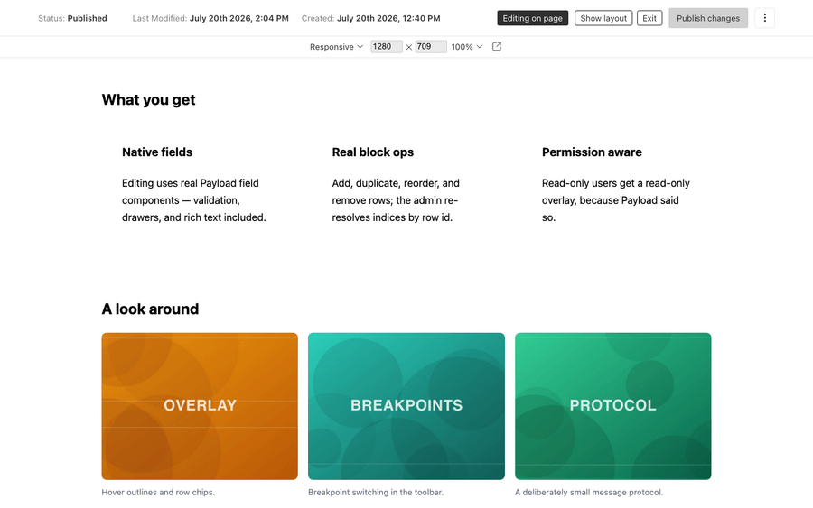
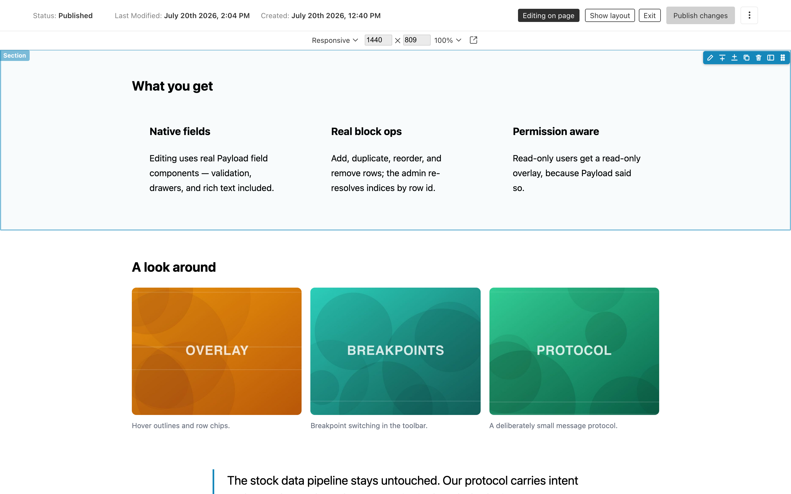
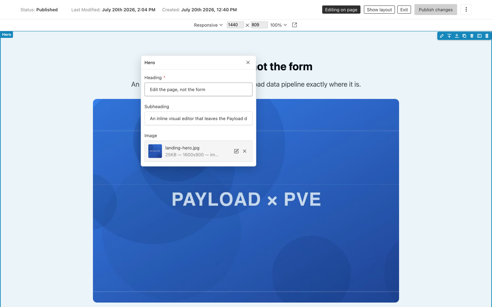
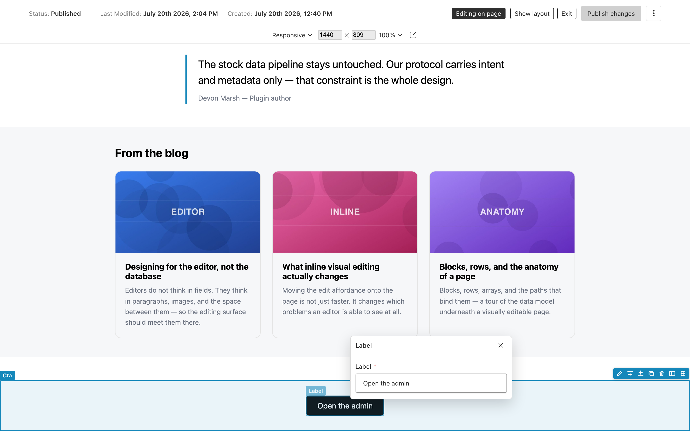
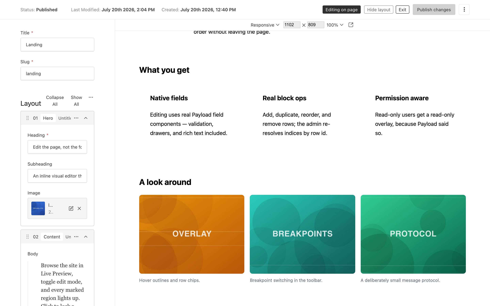

# payload-inline-visual-editor

Inline visual editing for [Payload CMS](https://payloadcms.com) 3.x — browse your site in Live Preview, toggle edit mode, hover-highlight editable regions, double-click to edit any field with native Payload field UI, and add / duplicate / remove / drag-reorder blocks directly on the page. A dedicated full-screen editor view, cross-document editing drawers, and a toolbar with save / publish / locale round it out.



The editor is layered on top of core Live Preview: the standard save / publish / autosave / versions / locales flow keeps working unchanged, document data flows through the stock Live Preview pipeline, and every field type (Lexical, uploads, relationships, custom plugin fields) gets native editing for free.

> **Status: 1.0.** The public API is stable; changes follow semver.

## A look around

|  |  |
|---|---|
| **Hover to find a block.** Every marked region outlines on hover, labelled with its block name, with row chips for edit · add above / below · duplicate · remove · reorder · show in layout.<br><br> | **Double-click a block to edit it.** The popover renders the block's own subfields — including uploads and rich text — bound to the same document form the sidebar uses.<br><br> |
| **Or edit a single field.** Double-click any individual marked field to get just that one, anchored next to what you clicked.<br><br> | **The full form is still there.** Toggle the layout panel for the stock Payload blocks UI beside the page — the two stay in sync, and "show in layout" jumps from a block to its row.<br><br> |

## Packages

| Package | Description |
|---|---|
| `payload-inline-visual-editor` | The Payload plugin (admin side) |
| `@payload-inline-visual-editor/core` | Framework-agnostic site SDK (vanilla TS, zero runtime deps) |
| `@payload-inline-visual-editor/react` | React/Next adapter: `<VisualEditing/>`, `payloadEditable()` |

## Requirements

- `payload@^3.85` (and `@payloadcms/ui@^3.85`)
- React 19 (the version Payload 3.x uses)
- A working [Live Preview](https://payloadcms.com/docs/live-preview/overview) setup for the collections/globals you want to edit

## Installation

```sh
pnpm add payload-inline-visual-editor @payload-inline-visual-editor/react
```

### 1. Add the plugin

```ts
// payload.config.ts
import { visualEditor } from 'payload-inline-visual-editor'

export default buildConfig({
  // ...
  plugins: [visualEditor()],
})
```

By default the editor enables itself for every collection and global that has a Live Preview URL (`admin.livePreview.url`, or a root `admin.livePreview` entry listing the slug). You can also enable entities explicitly — see [Plugin options](#plugin-options).

Then regenerate your import map so the admin controller component resolves:

```sh
payload generate:importmap
```

### 2. Mark up your frontend

The editor maps DOM to document data through explicit `data-pve-*` attributes. Paths are form-state data paths relative to the document root, e.g. `layout.0.heading`.

```tsx
import { payloadEditable } from '@payload-inline-visual-editor/react'

<main {...payloadEditable.scope({ collection: 'pages', id: page.id })}>
  <div {...payloadEditable.container('layout')}>
    {page.layout?.map((block, i) => (
      <section
        key={block.id}
        {...payloadEditable(`layout.${i}`, { row: { id: block.id, blockType: block.blockType } })}
      >
        <h1 {...payloadEditable(`layout.${i}.heading`)}>{block.heading}</h1>
      </section>
    ))}
  </div>
</main>
```

- `payloadEditable.scope(...)` marks the document a subtree belongs to — put it on the outermost element rendering that document. Globals: `payloadEditable.scope({ global: 'header' })`.
- `payloadEditable(path)` marks an editable leaf field.
- `payloadEditable(path, { row })` marks an array/blocks row wrapper. **Pass the row `id` Payload stores on every row** — block operations key off it. `id`/`blockType` accept the nullable types Payload generates, so `row: { id: block.id, blockType: block.blockType }` works as-is. If an id is missing at runtime the row degrades to a plain field and a dev-mode warning fires.
- `payloadEditable.container(path)` marks an array/blocks container — it bounds the drop zone and hosts the empty-state "add" affordance.

The helpers return plain `Record<string, string>` props, so they are RSC/SSR-safe — no client component needed for markup.

### 3. Mount the SDK

```tsx
import { VisualEditing } from '@payload-inline-visual-editor/react'

// In the page (or layout) that Live Preview loads:
<VisualEditing serverURL={process.env.NEXT_PUBLIC_SERVER_URL!} />
```

`serverURL` is your Payload server's origin — the SDK only accepts messages from it. The component renders nothing, only activates inside an iframe, and stays fully inert until it receives a valid handshake from the admin panel.

### 4. Edit

Open a document in the admin panel, enter Live Preview, and click **Edit on page**. Hover highlights editable regions; a click selects a region, and a double-click expands, scrolls to, and focuses the corresponding form field in the admin panel. Rows show a chip with edit / add / duplicate / remove / show-in-layout / drag-to-reorder.

## Choosing a preview mode

Both stock Live Preview modes work; they differ in how fast block operations reflect on the page:

| Mode | Setup | Behavior after an op |
|---|---|---|
| **Client mode** (recommended for editing) | [`useLivePreview`](https://payloadcms.com/docs/live-preview/client) | New data streams to the page immediately (~100 ms re-render) |
| **SSR mode** | [`RefreshRouteOnSave`](https://payloadcms.com/docs/live-preview/server) | Change lands after autosave + `router.refresh()` (1–3 s); the editor shows a pending shimmer on the affected container until the page catches up. Block ops in this mode require drafts + autosave |

The [dev playground](./dev) exercises both: [`dev/app/(frontend)/client-mode`](./dev/app/(frontend)/client-mode/%5Bslug%5D/page.client.tsx) and [`dev/app/(frontend)/ssr-mode`](./dev/app/(frontend)/ssr-mode/%5Bslug%5D/page.tsx).

## Dedicated editor view

Besides the "Edit on page" toggle inside the document edit view, the plugin registers a full-screen editor at `/admin/visual-editor/:collectionSlug/:id` (globals: `/admin/visual-editor/globals/:globalSlug`) — a bare view with no admin navigation: a top toolbar (document status, save / publish, locale switcher, exit) and the live preview filling the rest, with edit mode already on. The breakpoint / size / zoom controls of the stock preview toolbar sit above the preview. The fields panel is hidden by default — **Show layout** in the toolbar (or a block chip's **show in layout** button, which scrolls to that block with the other blocks collapsed) opens it.

Every enabled document gets an **Open visual editor** button in its edit view controls; **Exit** in the toolbar leads back. Deep links work — the view enforces admin authentication itself.

Inside the view, double-clicking a marked region — or clicking the **edit** button on a block's chip — opens a **near-cursor popover** that edits just that field: a leaf region edits the single field, a block/array row edits the row's fields — bound to the same form as the layout panel, so edits stream straight into the preview and save/publish/autosave behave exactly as in the edit view. Rich text renders the full Lexical editor; upload and relationship fields keep their native drawer flows. Close it with the ✕, <kbd>Escape</kbd>, or by clicking empty page space in the preview.

Double-clicking a region that belongs to a *different* document (a global header, a related doc) opens that document in a drawer, without leaving the page — saving it flows through the standard document-event path, so an SSR-mode preview refreshes automatically (client mode re-renders the current document's data only; other documents update on the next page load).

The view and its toolbar are configurable (see plugin options below): `view: { enabled: false }` removes the route, `view.path` relocates it, and `toolbar` hides individual controls.

## Draft mode & production stripping

**Point Live Preview at a draft-content route.** Edits happen on the working draft, so the previewed page must render draft content — the standard Payload + Next pattern is a preview route gated by [`draftMode()`](https://payloadcms.com/docs/live-preview/server) and a preview secret (see the official `templates/website`). Tell the SDK what it is looking at via the `draft` prop — the admin logs a warning when the preview renders published-only content (edits would not appear until published):

```tsx
<VisualEditing serverURL={serverURL} draft={(await draftMode()).isEnabled} />
```

**Strip attributes from production HTML.** `data-pve-*` attributes are harmless if they leak (the SDK is inert without an authenticated admin handshake), but you can keep public HTML clean:

```tsx
import { configurePayloadEditable } from '@payload-inline-visual-editor/react'

// Next: at the top of the preview-capable page/layout render
import { draftMode } from 'next/headers'
configurePayloadEditable({ enabled: (await draftMode()).isEnabled })
```

When `enabled` is `false`, every helper returns `{}` — zero attributes in the rendered HTML. If your site build never serves editors (e.g. a separate static production build), a static gate works too:

```ts
configurePayloadEditable({ enabled: process.env.NODE_ENV !== 'production' })
```

> `configurePayloadEditable` sets module-level state. Under concurrent server rendering a draft and a non-draft request can interleave, so treat it as HTML hygiene, not security — security comes from the handshake (attributes are inert without it) and from Payload's server-side access control.

## Cross-origin setups

The default documented path is a single Next app serving both the site and `/admin` (same origin — nothing to configure). If your site and Payload server run on **different origins**, the previewed site (inside the iframe) must be able to call the Payload REST API with the admin's auth cookie:

```ts
// payload.config.ts
export default buildConfig({
  cors: ['https://site.example.com'],
  csrf: ['https://site.example.com'],
  // The admin cookie must be sendable from the iframe's third-party context:
  // on your auth-enabled collection —
  // auth: { cookies: { sameSite: 'None', secure: true } }
})
```

- Client mode's live-preview population requests and any draft-content fetches from the site must use `credentials: 'include'`.
- `sameSite: 'None'` requires `secure: true` (HTTPS on both origins).
- Make sure the site allows being framed by the admin origin (no blanket `X-Frame-Options: DENY` / restrictive `frame-ancestors` on the preview route).

The visual editor's own admin↔site channel is `postMessage` with strict origin + session checks and needs no CORS.

## Plugin options

```ts
visualEditor({
  // Default: every collection/global with a Live Preview URL.
  // Listing entities explicitly enables only those listed:
  collections: {
    pages: true,
    posts: {
      url: ({ data }) => `${serverURL}/posts/${data?.slug}`, // override admin.livePreview.url
      blockOps: { add: true, duplicate: true, remove: false, move: true }, // or false to disable all
    },
  },
  globals: { header: true },
  view: {
    enabled: true, // false removes the dedicated view route
    path: '/visual-editor/:collectionSlug/:id', // must keep both params; globals mount at …/globals/:globalSlug
  },
  toolbar: {
    locale: true, // locale switcher in the dedicated view (localized projects)
    breakpoint: true, // stock preview toolbar (breakpoint / size / zoom) above the preview
    exit: true, // "Exit" link back to the standard edit view
  },
  debug: false, // verbose console logging on both sides of the bridge
})
```

An explicitly listed entity without a Live Preview URL (and no `url` override) throws at startup with an actionable message.

Per-entity `blockOps` gates which row operations the overlay offers. Field-level permissions are applied on top: the overlay hides affordances for paths the current user cannot update, and Payload's server-side access control stays authoritative regardless.

## Attribute reference

For non-React frontends, `@payload-inline-visual-editor/core` ships the same helpers as vanilla functions (`pveAttr.scope/field/row/container`), or you can write the attributes by hand:

| Attribute | Meaning | Example |
|---|---|---|
| `data-pve-scope` | Document scope; nearest ancestor wins | `collection:pages;id:665f…`, `global:header` |
| `data-pve-field` | Editable leaf field (data path) | `layout.0.heading` |
| `data-pve-field` + `data-pve-row` (+ `data-pve-block-type`) | Array/blocks row wrapper | `layout.0` + row id + `hero` |
| `data-pve-container` | Array/blocks container | `layout` |

Mounting without React:

```ts
import { initVisualEditing } from '@payload-inline-visual-editor/core'

if (window.self !== window.top) {
  const teardown = initVisualEditing({ serverURL: 'https://cms.example.com' })
}
```

## Security model

- The SDK is inert until a valid `hello` from the configured admin origin; every message is checked against origin, `event.source`, and a per-load session id. No `'*'` postMessage targets.
- The intent channel carries paths and row ids only — document data flows exclusively through Payload's stock Live Preview pipeline.
- Edit mode can only be initiated from an authenticated admin session; all mutations execute in the admin form and pass through Payload's access control on save.

## Development

```sh
pnpm install
pnpm build        # build packages (core → plugin/react)
pnpm test         # vitest int tests (run build first)
pnpm dev          # playground at http://localhost:3000
pnpm e2e          # Playwright e2e (starts the playground itself)
```

Playground admin: `http://localhost:3000/admin` — `dev@payloadcms.com` / `test` (seeded on first run; `viewer@payloadcms.com` / `test` is a read-only account for permission testing). Open the seeded **Home** page and switch to Live Preview.

## Changelog

Release notes live in [CHANGELOG.md](./CHANGELOG.md).

## License

[MIT](./LICENSE)
